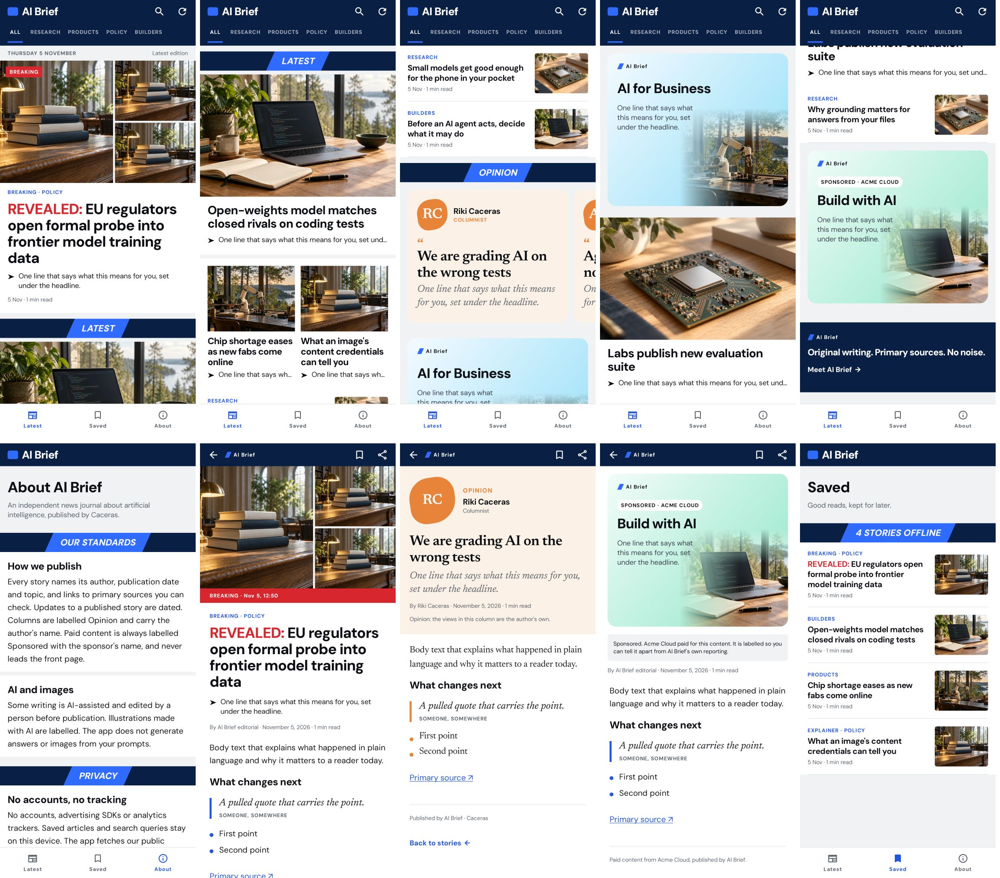

# AI Brief design system

AI Brief looks like a modern headline news app: a navy masthead, heavy sans
headlines, a one-line deck after a ➤, square-cornered photos, slanted section
ribbons, and a distinct look for each kind of story. The rules below are
enforced in code, not left to taste.

## How the rules are enforced

| Rule | Where it lives | What fails if broken |
|---|---|---|
| Colours, fonts, type sizes and weights, corner shapes and spacing are defined once | `ui/theme/Theme.kt` | `DesignRulesTest` fails the build on any raw `Color(0x…)`, `.sp`, `FontWeight.`, `FontFamily`/`Font(`, `MaterialTheme.typography`/`colorScheme`, `RoundedCornerShape(`, or literal dp in `padding`, `spacedBy`, `Spacer` or `widthIn(max = …)` anywhere else |
| Each story type has exactly one card and one reader header | `ui/components/StoryCards.kt`, `ArticleReader.kt` | Posts cannot carry styling; unknown fields are ignored |
| Front-page order | `FeedLayout.kt` | `FeedLayoutTest` |
| Story types, limits and labels | `scripts/publish-post.py`, `OwnerPosts` parser | `test_publishing.py`, `StoryFormatTest`, the Content workflow |

To change the look, change a token in `Theme.kt`, and the whole app follows.
Adding a one-off value on a screen is not allowed. If a screen genuinely
needs something new, add a named token or role for it first.

## Tokens

- **Colour roles** (`Brief.colors`): paper, card, ink, inkMuted, rule, masthead, onMasthead, mastheadAction,
  ribbonLabel, accent, onAccent, breaking, onBreaking, opinionPaper, opinionAccent, placeholder,
  onImage, imageScrim. Light and dark themes define every role. `breaking` red is used only for
  breaking labels and kickers.
- **Type** (`Brief.type`): display, headline, headlineSmall, rowTitle, deck, label, tag, meta, body,
  bodyHeading, wordmark, pageTitle, opinionHeadline, opinionBody, quote, designedTitle, button, ribbon.
  Headlines are DM Sans ExtraBold; columns and quotes are Newsreader. No other faces.
- **Spacing** (`Space`): hairline 1, xxs 2, xs 4, s 8, m 12, gutter 16, l 20, xl 24, xxl 32, section 40 (dp).
- **Widths** (`Measure`): every screen is centred in a `page` column of 840 dp; reading text in the story reader stops at `text`, 640 dp (about 70 characters), so tablets and landscape phones keep a readable line length while pictures use the full column.
  Every screen uses the 16 dp gutter.
- **Shapes** (`BriefShapes`): none (news photos), thumb 4, button 6, card 18, pill, round, portraitBlob.
- **Card themes** (`CardTheme`): SKY, LILAC, MINT, PEACH, BLUSH (light), OCEAN, INDIGO, NAVY (dark).
  A post names one and cannot add colours of its own.
- **Photo ratios** (`Ratio`): hero 16:10, pair 4:3, thumbnail 4:3.

## Story types

| Type | Card | Reader header | Rules |
|---|---|---|---|
| News | Full-bleed photo, heavy headline, ➤ deck | Photo, tag, display headline, deck, byline | Default for unknown types |
| Breaking | Collage of 1–3 photos, red BREAKING flag, red kicker before the headline | Collage, red strip with time | Leads the front page for 24 h. Only type with a collage |
| Explainer | As News, tagged EXPLAINER | As News | Background reading |
| Opinion | Warm paper, portrait on an orange blob (or initials), serif headline | Portrait, OPINION label, serif body, "views are the author's own" note | Must be signed by a named person. Grouped in one Opinion rail |
| Guide | Designed gradient card with the brand mark and the cover fading in | The same card | Our own playbooks. Never leads while there is news |
| Sponsored | Guide card plus a SPONSORED · NAME pill | Card plus a paid-content notice | Sponsor is required, or the post is not shown. Never leads, never first in the closing run |

Optional fields on any post: `kicker` (red lead-in, at most 24 characters), `updatedAt`
(shown as "Updated …"), `authorRole`, `authorImageUrl`.

## Front page order (`FeedLayout`)

1. Lead: the newest breaking story from the last 24 hours, otherwise the newest news story.
2. A ribbon (HEADLINES, or LATEST under breaking news), then news in a repeating rhythm:
   one big headline, a pair, two rows.
3. All columns, together in one Opinion rail, after the first rhythm.
4. At most one designed card after each rhythm, so two never touch, and none directly under the lead.
5. Leftover guides and sponsored posts close the page under GUIDES, sponsored last.

Search results and the Saved list use rows only.

## Writing to the system

- Headlines: up to 120 characters; aim for under 70. Concrete subject and verb.
- Deck: one sentence (up to 220 characters) that says what the story means for the reader.
- Kicker: one or two words ("Revealed", "Exclusive", "Update"). Use sparingly.
- Pictures: only ones you own or are licensed to use. Logos and photos of people in breaking
  collages must be editorial (identifying who the story is about), never implying endorsement.

Render the screens again with `scripts/render-snapshots.sh` (no device needed).
